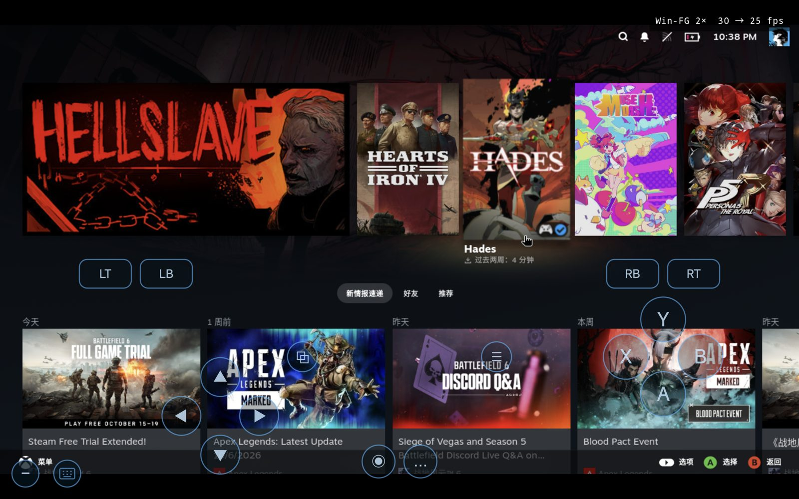

# DroidDeck on Redmi K Pad (Dimensity 9400+ / MT8799)

**Status: initial run achieved** — Steam Big Picture runs on the tablet, Windows games launch from
the library and render, and input reaches the game.

[English](README.md) · [简体中文](README.zh-CN.md)

This is a fork of [DroidDeck](https://github.com/Droid-Deck/DroidDeck) for the **Redmi K Pad
(25079RPDCC)**: SoC **MT8799 / Dimensity 9400+**, GPU **Mali-G925-Immortalis MC12** (`0xd8300015`,
pan_arch 13, kbase CSF UAPI 1.30), Android 16, locked bootloader, no root.

> Not affiliated with Valve, MediaTek, or the upstream DroidDeck project.

<p align="center"></p>

## Download

| What | Where |
|---|---|
| **Source** | this repository (`git clone`) |
| **APK** | [Releases](../../releases) → `DroidDeck-KPad-0.4.0-sl1-debug.apk` |
| **Driver** | [Releases](../../releases) → `DroidDeck-PanVK-G925-main186-p1.zip` |

The APK is debug-signed. If a build with a different signature is installed, uninstall it first. The
driver zip is the package accepted by **Components → GPU drivers → Import .zip**.

## Display path

Without root there is no DRM render node, so the guest has `/dev/mali0` but not
`/dev/dri/renderD128`. Xwayland's glamor needs EGL + GBM + a render node, and Chromium/CEF needs an
EGL context on the surface; neither is available. The working stack renders into a software X server
and presents the framebuffer through the GPU compositor:

```
Steam / Windows game (Proton ARM64 → Wine → FEX → DXVK)
  → Xvfb :7 (swrast GLX, framebuffer in /tmp/xvfb-fb)
  → xpresent (mmap → XDamage dirty rects → wl_shm → wl_surface)
  → DroidDeck's Wayland compositor (Vulkan on the Mali vendor driver)
  → SurfaceView

Input: compositor wl_pointer/wl_keyboard → xpresent → XTEST → Xvfb → Steam/game
Window management: xraise/xhide (Xvfb has no window manager)
```

The Steam client and games share one display (`BL_XWAYLAND_COUNT=1`), so overlay, focus and
controller routing stay in one X server.

## Driver

The runtime driver is Mesa's PanVK kbase path, built from Mesa `5a07217f` with the upstream
`csf-v11` series (179 patches) plus two local patches:

* **subqueue timeout protection** — kbase declares a subqueue lost after 10 s without progress; the
  patch extends that window while `extract`/`seqno`/`stream_progress` still advance (capped).
* **Vulkan 1.4 core command aliases** — `vkCmdBindDescriptorSets2` and `vkCmdPushConstants2` are
  exported as aliases of the KHR entry points.

Build steps, patch details, validation method and the toolchain are documented in
[docs/DRIVER.md](docs/DRIVER.md); the sources are in [driver/](driver/).

## Development tools

| Tool | Location | Purpose |
|---|---|---|
| Driver build scripts | `driver/build/00-env.sh` … `40b-verify.sh` | toolchain, patching, cross-build, ELF/symbol verification |
| Test builder | `driver/build/60-build-tests.sh`, `63-build-all-tests.sh` | compiles the Vulkan test programs |
| Profile and metadata | `driver/profile/`, `driver/meta/` | GPU profile and package metadata |
| App build | `tools/release/build-mt8799.ps1` | APK build (Windows) |
| Guest-script hashes | `tools/release/runtime_inputs.py` | records `runtime-inputs.json` after editing `tools/linuxfs/overlay/**` |
| Presenter | `tools/xtools/xpresent.c` (guest `/root/xpresent`) | Xvfb framebuffer → Wayland surface |
| Window control | `tools/xtools/xraise.c`, `xhide.c` (guest `/root/xraise`, `/root/xhide`) | raise/alt-tab and hide/show for the Steam UI |
| Session logs | `files/logs/<session>/` | `session.log`, `wayland.log`, `xpresent.out` |

## Current limitations

* **Performance is low**: the Steam UI runs at roughly 13–16 fps, and games are not yet optimised for
  this path; frame pacing and the copy path still have headroom.
* The Steam UI stays on software rasterisation; [docs/UI-ACCELERATION-POSTMORTEM.md](docs/UI-ACCELERATION-POSTMORTEM.md)
  explains why hardware GL cannot be wired into the CEF that Steam runs on this device.
* Steam's CEF is software-rasterised, which is the main cause of the low UI frame rate.
* `p8-common-gates` hits SIGSEGV on recent builds; not yet root-caused.
* No bionic build, so PanProbe cannot load the driver inside an Android process.
* No dmabuf/GBM export, so the display path copies frames instead of sharing them.
* G925 on MT8799 is outside upstream's validation matrix.
* The game and the Steam client share one Xvfb; window placement uses the minimal window manager.

## Build

JDK 17, Android SDK (compileSdk 34), NDK 30. After editing guest scripts:

```bash
python3 tools/release/runtime_inputs.py record
```

Windows: `powershell -File tools/release/build-mt8799.ps1 -Project . -Log build.log`
Other platforms: `./gradlew :app:assembleDebug`

## Install

1. Install the APK and grant storage access.
2. **Components → GPU drivers → Import .zip** → select the driver zip (runtime driver).
3. Write the session switches into `Android/data/dev.hayash1.steamoslite/files/droiddeck-env`:

   ```
   MESA_LOG=android,file
   PANVK_KBASE_GPU_SEMAPHORE_WAITS=0
   BL_NO_GAMESCOPE=1
   BL_STEAM_SOFT_CEF=1
   BL_STEAM_XVFB=1
   ```

4. Start the session and sign in. Steam downloads its client on first launch.

## Contributors

* Maintainer: **Markis Lin** — device work, application, testing
* **DeepSeek** (AI pair programmer) — driver research, debugging, display path, documentation

## Contributing

Reproducible reports with checkable evidence are the most useful. See
[CONTRIBUTING.md](CONTRIBUTING.md); open items are listed at the end of [docs/DRIVER.md](docs/DRIVER.md).

## Licence

GPL-3.0, inherited from DroidDeck. Third-party components are listed in [NOTICE.md](NOTICE.md).
Steam and Proton belong to Valve Corporation and are not bundled.
